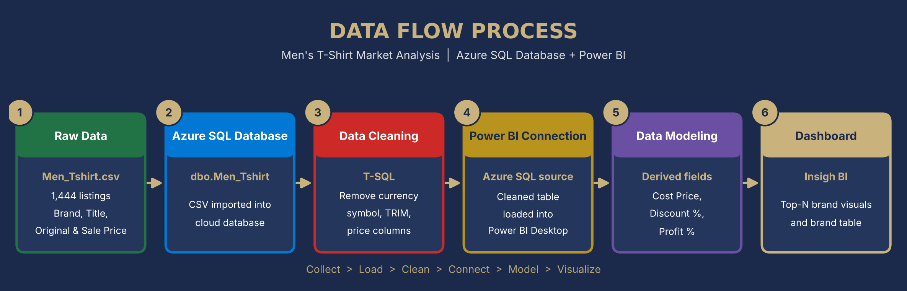

<div align="center">

# 👕 Men's T-Shirt Market Analysis

### End-to-end data analytics project using **Azure SQL Database**, **SQL** and **Power BI**


<br>

📷 **Dashboard Preview:** 

<br>

<a href="images/dashboard_cover.png"></a>
<a href="images/dashboard_overview.png"></a>

<sub>Click an image to view it full size</sub>

</div>

---

## 📌 Table of Contents

1. [Project Overview](#-project-overview)
2. [Business Questions](#-business-questions)
3. [Tech Stack](#-tech-stack)
4. [Project Workflow](#-project-workflow)
5. [Dataset](#-dataset)
6. [Data Cleaning in Azure SQL](#-data-cleaning-in-azure-sql)
7. [Data Modeling](#-data-modeling)
8. [Dashboard](#-dashboard)
9. [Key Insights](#-key-insights)
10. [Repository Structure](#-repository-structure)
11. [How to Reproduce](#-how-to-reproduce)
12. [Author](#-author)

---

## 🎯 Project Overview

This project analyzes pricing, discounting and profitability of **men's apparel listings across 140+ brands** scraped from an Indian e-commerce marketplace. Raw data in CSV format was loaded into a **Microsoft Azure SQL Database**, cleaned and prepared with **T-SQL**, and then visualized in an interactive **Power BI** dashboard (*Insigh BI*) that makes brand-level comparisons easy.

The goal is to turn a messy, text-based price listing into a decision-ready report that shows which brands discount the most, which are the most premium, which earn the highest margins, and which have the widest product range.

---

## ❓ Business Questions

| # | Question |
|---|----------|
| 1 | Which brands offer the highest average discount? |
| 2 | Which brands sit at the premium end by average sale price? |
| 3 | Which brands have the highest and lowest average profit percentage? |
| 4 | Which brands offer the widest variety of products? |

---

## 🛠 Tech Stack

| Layer | Tool | Purpose |
|-------|------|---------|
| Storage | **Microsoft Azure SQL Database** | Cloud-hosted relational database for the raw and cleaned data |
| Transformation | **T-SQL** (Azure Data Studio / SSMS) | Data profiling and cleaning |
| Modeling & Visualization | **Power BI Desktop** | Derived fields, DAX, interactive dashboard |
| Source | **CSV** | Raw product listing data |

---

## 🔄 Project Workflow

<div align="center">



</div>

### Process in detail

| Step | Stage | Description |
|------|-------|-------------|
| 1 | **Collect** | Raw product listings (brand, title, original price, sale price) stored in `Men_Tshirt.csv`. |
| 2 | **Load** | The CSV is imported into an **Azure SQL Database** table `dbo.Men_Tshirt`. |
| 3 | **Profile** | Quick inspection with `SELECT TOP (1000) *` to check structure, data types and quality issues. |
| 4 | **Clean** | Price columns contained currency symbols that were stored as `?` after import. These were stripped and trimmed with T-SQL `UPDATE` statements. |
| 5 | **Connect** | Power BI Desktop connects to the Azure SQL Database and reads the cleaned `Men_Tshirt` table. |
| 6 | **Model** | Numeric price fields and derived metrics (**Cost Price**, **Discount %**, **Profit %**) are prepared for analysis. |
| 7 | **Visualize** | A themed dashboard with Top-N brand visuals is built and published as `Tshirts.pbix`. |
| 8 | **Interpret** | Findings are summarized into brand-level insights. |

---

## 📂 Dataset

| Attribute | Details |
|-----------|---------|
| **File** | `Men_Tshirt.csv` |
| **Records** | 1,444 product listings |
| **Unique brands** | 144 |
| **Currency** | Indian Rupee (₹) |

### Columns

| Column | Description |
|--------|-------------|
| `Brand` | Brand name of the product |
| `Title` | Product title / description |
| `Original Price` | Marked price (MRP) before discount |
| `Sale Price` | Selling price after discount |

### Data quality observations

| Issue | Count | Handling |
|-------|-------|----------|
| Price columns stored as text with currency symbol and thousand separators (e.g. `₹1,749`) | All rows | Cleaned in Azure SQL |
| Missing `Original Price` | 150 | Excluded from discount and profit calculations |
| Missing `Brand` / `Title` / `Sale Price` | 15 / 16 / 16 | Excluded from brand-level analysis where relevant |
| Exact duplicate rows | 341 | Identified during profiling |

**Price snapshot (₹):**

| Metric | Original Price | Sale Price |
|--------|---------------:|-----------:|
| Minimum | 499 | 210 |
| Median | 1,999 | 699 |
| Mean | ~2,416 | ~1,034 |
| Maximum | 17,999 | 12,999 |

---

## 🧹 Data Cleaning in Azure SQL

The raw CSV is loaded into the `Men_Tshirt` table in Azure SQL Database. The price columns arrive as text with a currency symbol (shown as `?` after import), which prevents numeric analysis. The following T-SQL removes the symbol and trims whitespace.

```sql
-- Preview the data
SELECT TOP (1000) * FROM [dbo].[Men_Tshirt];

-- Clean the Original_Price column
UPDATE Men_Tshirt
SET Original_Price = TRIM(REPLACE(CAST(Original_Price AS VARCHAR(MAX)), '?', ''))
WHERE Original_Price LIKE '%?%';

-- Clean the Sale_Price column
UPDATE Men_Tshirt
SET Sale_Price = TRIM(REPLACE(CAST(Sale_Price AS VARCHAR(MAX)), '?', ''))
WHERE Sale_Price LIKE '%?%';
```

📁 Scripts: [`sql/T-Shirt_sql_azure.sql`](sql/T-Shirt_sql_azure.sql) · [`sql/Tshirts.sql`](sql/Tshirts.sql)

---

## 🧮 Data Modeling

After connecting Power BI to the Azure SQL Database, the `Men_Tshirt` table exposes the following fields:

| Field | Type | Description |
|-------|------|-------------|
| `Brand` | Dimension | Brand name |
| `Title` | Dimension | Product title |
| `Marked price` | Numeric | Original price before discount |
| `Sales Price` | Numeric | Final selling price |
| `Cost Price` | Derived | Estimated cost used for margin analysis |
| `Discount %` | Derived | Percentage reduction from marked price to sales price |
| `Profit %` | Derived | Profit margin percentage |

Brand-level metrics are produced by averaging these fields per brand and ranking them with **Top N** filters.

---

## 📊 Dashboard

The Power BI report (`Tshirts.pbix`) has two pages in a navy and gold theme.

### Page 1: Cover / Brands

A branded landing page ("Exclusive Men's Collection, Insigh BI") with a scrollable **Brand** list for quick brand lookup.

<!-- <a href="images/dashboard_cover.png"></a> -->

### Page 2: Main Dashboard (Insigh BI Solution Private Limited)

| Visual | Chart Type | Insight Delivered |
|--------|-----------|-------------------|
| Top 5 Brands by Average Discount % | Bar chart | Brands that discount most aggressively |
| Top 5 Brands by Highest Avg Profit Percent | Area chart | Brands with the strongest margins |
| Top 5 Brands by Highest Varieties | Donut chart | Brands with the widest product range |
| Top 5 Brands by Highest Average Sales Price | Ribbon chart | Most premium brands by price point |
| Bottom 5 Brands by Average Profit Percentage | Pie chart | Brands with the thinnest margins |

<!-- <a href="images/dashboard_overview.png"></a> -->

---

## 💡 Key Insights

- 🏷️ **Discounting:** The most aggressive discounters are **iVOC (89%)**, **WUXI**, **Mischief Monkey** and **Voroxy X AG** (85% each) and **Red Tape (83%)**, which means their sale prices sit far below the marked price.
- 💎 **Premium segment:** **Armani Exchange** leads on average sales price at about ₹6.1K, followed by **Brooks Brothers** (₹5.1K), **Terra Luna** (₹5.0K), **Scotch & Soda** (₹4.5K) and **Kingdom of White** (₹3.6K).
- 📈 **Margins:** Average profit tops out at about **17%** (Fashion 2 Wear, Lonexo, Marmic Fab, US Polo Assn.), while the lowest-margin brands sit at about **2%** (Tyzlo, Ad By Arvind, Basics, Cantabil, Charles Tyrwhitt, Joven).
- 👕 **Variety:** **The Indian Garage Co** has the widest range with 184 listings, about 36% of the 512 listings across the top 5 brands, followed by **U.S. Polo Assn.** (107), **Netplay** (90), **Snitch** (50) and **The Bear House** (49).
- 🔎 **Takeaway:** Deep discounts do not signal luxury pricing. The premium brands (Armani Exchange, Brooks Brothers) are not the ones with the heaviest discounts.

---

## 🗂 Repository Structure

```
mens-tshirt-analysis/
│
├── data/
│   └── Men_Tshirt.csv            # Raw dataset
│
├── sql/
│   ├── T-Shirt_sql_azure.sql     # Cleaning scripts (Azure SQL)
│   └── Tshirts.sql               # Data preview query
│
├── powerbi/
│   └── Tshirts.pbix              # Power BI report
│
├── images/
│   ├── data_flow.png             # Data flow diagram
│   ├── dashboard_cover.png       # Cover page screenshot
│   └── dashboard_overview.png    # Main dashboard screenshot
│
└── README.md
```

---

## 🚀 How to Reproduce

1. **Create an Azure SQL Database** in the Azure Portal and allow your client IP in the server firewall.
2. **Import `Men_Tshirt.csv`** into a table named `dbo.Men_Tshirt` using Azure Data Studio or the SSMS Import Flat File wizard.
3. **Run the cleaning script** in `sql/T-Shirt_sql_azure.sql`.
4. **Open `powerbi/Tshirts.pbix`** in Power BI Desktop.
5. Go to **Home → Transform data → Data source settings** and point the connection to your own Azure SQL server and database.
6. Click **Refresh** to load the data and explore the dashboard.

---

## 👤 Author

**Zakariya Gezali**
Aspiring Data Analyst · Power BI · SQL · Excel · Python · Tableau

[](https://github.com/gezali)

---

<div align="center">

⭐ If you found this project useful, consider giving it a star.

</div>
